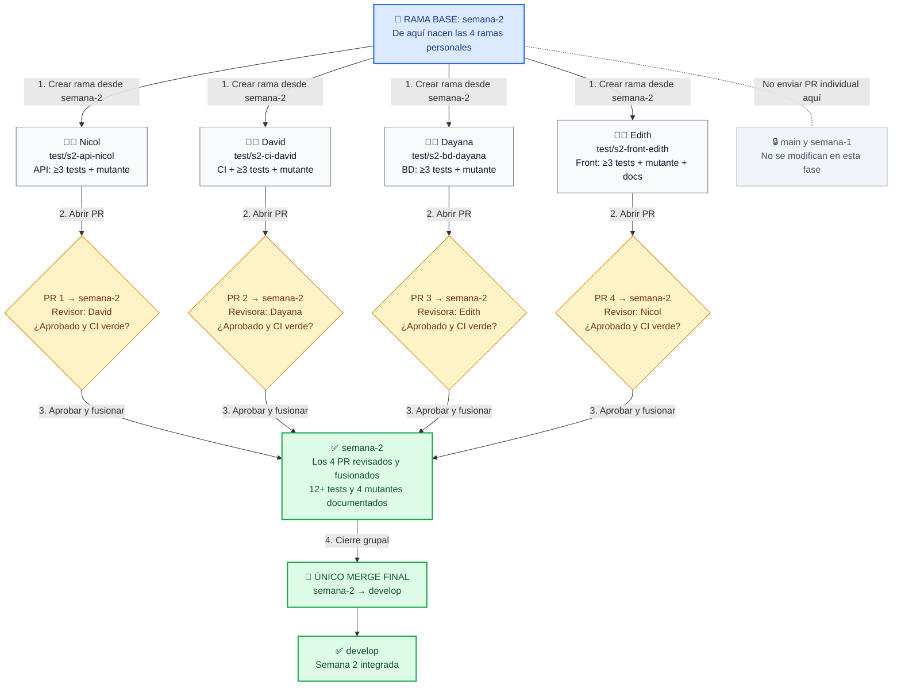

# 🧪 SIHS · Semana 2 — Pruebas unitarias y CI

> **Rama activa:** `semana-2` · **Equipo:** Nicol, David, Dayana y Edith · **Objetivo:** mínimo 3 tests unitarios y 1 mutación documentada por integrante; CI en verde y cobertura sin retrocesos.

**Este README es la portada de trabajo de la rama `semana-2`.** Por ahora solo se actualiza en esta rama; `main`, `develop` y `semana-1` conservan su README. El proyecto general y sus instrucciones de instalación se mantienen más abajo.

## 🎯 Entregables de la semana

| Responsable | Capa asignada | Trabajo individual | Rama personal |
|---|---|---|---|
| **Nicol** | **API / servicios** | ≥ 3 tests unitarios de reglas de negocio del backend con pytest; límites y mutante | `test/s2-api-nicol` |
| **David** | **CI + tests unitarios** | ≥ 3 tests unitarios propios, un mutante, `.github/workflows/tests.yml`, control de cobertura y evidencia de CI rojo/verde | `test/s2-ci-david` |
| **Dayana** | **BD / modelos** | ≥ 3 tests unitarios de validaciones, conversiones o cálculos sobre registros, sin repetir las unidades de Nicol | `test/s2-bd-dayana` |
| **Edith** | **Frontend + documentación** | ≥ 3 tests unitarios de lógica pura con Vitest, mutante y actualización de `docs/matriz-rotacion.md` y la documentación de S2 | `test/s2-front-edith` |

**Mínimo grupal:** 12 tests unitarios nuevos, 4 mutaciones manuales que provoquen un fallo, 4 PR individuales revisados y una sola integración final hacia `develop`.

### Qué debe aportar cada integrante

- Seleccionar una **regla de negocio real** (condición, cálculo o validación); no basta probar getters ni delegaciones.
- Escribir **al menos 3 tests unitarios** con aserciones, particiones y **valores límite**. Controlar por parámetro fechas, azar o configuración cuando corresponda.
- Realizar una **mutación manual** (por ejemplo, cambiar `>` por `>=`), ejecutar los tests, identificar cuál falla y **restaurar el código correcto**.
- Crear los commits desde su **propia cuenta de GitHub** y abrir un único PR de su rama hacia `semana-2`.
- Documentar en el PR: regla probada, casos límite, mutante introducido, prueba que lo detectó y evidencia de tests/CI.

## 🔄 Flujo de ramas y revisiones — exactamente 4 PR personales

> **Regla principal:** todos parten de `semana-2`, **ningún PR individual apunta a `develop`**, y solo después de integrar los cuatro se hace **un único merge de `semana-2` a `develop`**. `main` y `semana-1` no se modifican durante este proceso.

### Diagrama visual (Mermaid)



### Cómo leer el diagrama

| Paso | ¿Qué sucede? | ¿Dónde queda el código? |
|---|---|---|
| **1. Crear rama** | Cada integrante se cambia a `semana-2`, trae sus últimos cambios y crea su rama personal. | En su propia `test/s2-...` |
| **2. Trabajar y abrir PR** | Cada persona desarrolla ≥3 tests unitarios, documenta un mutante y envía **un solo PR**. David agrega CI; Edith agrega documentación. | **PR: rama personal → `semana-2`** |
| **3. Revisión cruzada** | David revisa a Nicol; Dayana a David; Edith a Dayana; Nicol a Edith. Si falta algo o falla CI, **se corrige en la misma rama y el mismo PR**. | PR abierto hasta aprobación y CI verde |
| **4. Integrar los cuatro** | Cada PR aprobado se fusiona individualmente. El equipo comprueba matriz, cobertura y evidencia. | Todo reunido en `semana-2` |
| **5. Único cierre** | Se realiza **un solo merge de `semana-2` a `develop`**. No se abre un quinto PR individual para cobertura o docs. | `develop` recibe la Semana 2 |

**Ejemplo de comandos que ejecuta cada integrante (sustituir solo el nombre de rama):**

```bash
git fetch origin
git switch semana-2
git pull origin semana-2
git switch -c test/s2-api-nicol
# Trabajar, ejecutar tests y documentar mutación...
git add .
git commit -m "test(s2): pruebas unitarias de reglas API"
git push -u origin test/s2-api-nicol
```

Al abrir el PR en GitHub, verificar **base: `semana-2` ← compare: `test/s2-api-nicol`**. Si no está verde o no tiene aprobación cruzada, **no fusionar**. Los demás usan el nombre exacto de su rama indicado en la tabla de responsabilidades.

## 🛡️ CI, cobertura y reglas del reto

**David** configura `.github/workflows/tests.yml` con tests y cobertura de frontend y backend. Debe demostrar que el job se pone rojo cuando se incumple un umbral, y vuelve a verde al restaurar la condición correcta. El grupo activa la protección de rama o registra la **regla manual** en la matriz si no está disponible.

**Edith** registra la columna S2, responsables, PR, revisores y cobertura real en [`docs/matriz-rotacion.md`](./docs/matriz-rotacion.md), además de documentar cómo ejecutar las pruebas y las reglas del equipo.

| Área | Umbral heredado de la semana 1 |
|---|---|
| Backend (global) | **84 %** |
| Frontend — sentencias | **76,73 %** |
| Frontend — ramas | **64,85 %** |
| Frontend — funciones | **73,89 %** |
| Frontend — líneas | **79,59 %** |

El reto de S2 exige **al menos 30 %** en frontend y backend, pero **no se rebajan** los umbrales ya establecidos. David incorpora el ajuste de umbrales **en su propio PR**, sin PR adicional, y Edith registra la cobertura medida. No excluir archivos de lógica de negocio ni usar tests sin aserciones para inflar resultados.

> **Compatibilidad con la consigna del instructor:** el reto original pide `tests.yml` y la medición final en `main`, además de un PR exclusivo de umbrales. Nuestro flujo acordado limita el trabajo a 4 PR hacia `semana-2` y una integración a `develop`; antes de declarar el reto cumplido literalmente, habrá que gestionar y evidenciar esos requisitos de `main` según lo que autorice el equipo/instructor.

## ✅ Checklist de cierre

- [ ] Los cuatro integrantes crearon su rama desde `semana-2`.
- [ ] Hay **≥ 3 tests unitarios nuevos por persona** sobre unidades distintas.
- [ ] Existen **4 mutantes documentados**, detectados por pruebas que fallaron.
- [ ] Los **4 PR** tienen revisión cruzada y CI verde antes del merge.
- [ ] `.github/workflows/tests.yml` funciona y existe evidencia de **CI rojo/verde**.
- [ ] Protección de rama activa o regla manual anotada en la matriz.
- [ ] La matriz de rotación y la cobertura real de frontend/backend están actualizadas.
- [ ] Los umbrales respetan el piso de 30 % y **no retroceden** respecto a S1.
- [ ] Los cuatro PR están en `semana-2` y se realizó **una única integración** a `develop`.
- [ ] El equipo puede explicar una prueba de una capa ajena y hacer una mutación en vivo.

**Referencia oficial:** [Bootcamp de testing ADSO — Semana 2](https://github.com/ergrato-dev/bc-testing-adso/tree/main/bootcamp/week-02-pruebas_unitarias_y_ci).

---

## 📘 Información general del proyecto

### SIHS — Sistema de Información de Horarios SENA

SIHS es un monorepo con una API REST, un cliente web y una aplicación móvil
para consultar y gestionar información académica y horarios. Los tres
clientes usan Supabase para autenticación y PostgreSQL; la web y el móvil
consumen la API FastAPI.

## Inicio rápido

### Requisitos

- Git
- Python y Node.js
- Flutter SDK, solo para ejecutar la aplicación móvil
- Acceso al proyecto Supabase del equipo

Antes de iniciar, configura las variables de entorno siguiendo
[`database/README.md`](./database/README.md). No compartas ni subas archivos
`.env`.

### Backend

En PowerShell:

```powershell
cd backend
python -m venv .venv
.\.venv\Scripts\Activate.ps1
python -m pip install -r requirements.txt
Copy-Item .env.example .env
uvicorn app.main:app --reload
```

La API queda en `http://127.0.0.1:8000`; Swagger, en
`http://127.0.0.1:8000/docs`. Completa `backend/.env` antes de usar las
funciones que requieren Supabase.

### Aplicación web

En otra terminal de PowerShell:

```powershell
cd frontend
pnpm install
Copy-Item .env.example .env
pnpm dev
```

Vite muestra la URL local, normalmente `http://localhost:5173`. Consulta
[`frontend/README.md`](./frontend/README.md) para pruebas unitarias y E2E.

### Aplicación móvil (opcional)

```powershell
cd mobile
flutter pub get
Copy-Item .env.example .env
flutter run
```

La configuración de red para emuladores y dispositivos físicos está en
[`mobile/README.md`](./mobile/README.md).

## Estructura

| Ruta | Contenido |
|---|---|
| [`backend/`](./backend/) | API FastAPI, reglas de negocio, pruebas y migraciones Alembic |
| [`frontend/`](./frontend/) | Cliente web React, TypeScript y Vite |
| [`mobile/`](./mobile/) | Aplicación Flutter |
| [`database/`](./database/) | Esquema SQL y guía de Supabase |
| [`_Docs/`](./_Docs/) | Documentación funcional, técnica y de diseño |

Guías de referencia:

- [Arquitectura móvil](./_Docs/Arquitectura/ARQUITECTURA_MOBILE.md)
- [Flujo de trabajo del monorepo](./_Docs/Documentación%20general/GUIA_MONOREPO.md)
- [Índice de informes de pruebas](./_Docs/Informes%20de%20pruebas/README.md)

Cada componente mantiene su propia guía de ejecución. Para cambios de esquema
de base de datos, revisa primero
[`database/README.md`](./database/README.md); no ejecutes scripts de creación,
datos de prueba o migraciones contra una base compartida sin autorización.

## Flujo de trabajo

El trabajo se integra normalmente mediante Pull Request hacia `develop`. Crea
una rama para cada cambio:

```powershell
git switch develop
git pull origin develop
git switch -c feature/nombre-del-cambio
```

Al terminar:

```powershell
git add ruta/de/los/archivos
git commit -m "tipo(área): descripción breve"
git push -u origin feature/nombre-del-cambio
```

## Licencia y autores

Proyecto académico desarrollado en el programa de formación ADSO del SENA.
